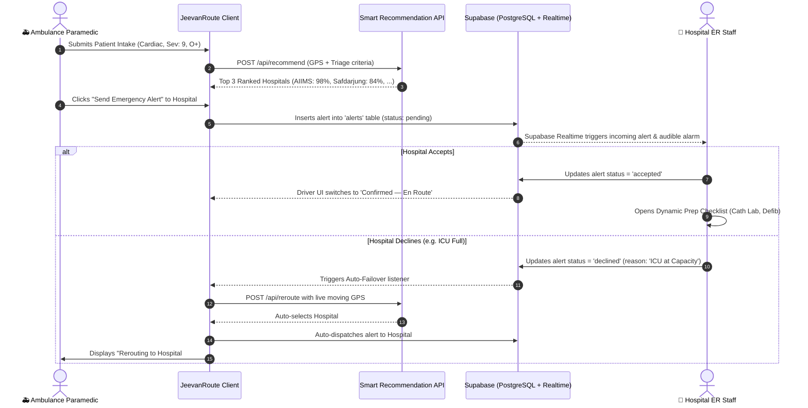

# 🚑 JeevanRoute
### Smart Algorithm-Driven Ambulance Routing & Real-Time Emergency Coordination System
*Get to the Right Hospital, Not Just the Nearest One*

[](https://nextjs.org)
[](https://react.dev)
[](https://www.typescriptlang.org)
[](https://tailwindcss.com)
[](https://supabase.com)
[](https://maplibre.org)
[](https://opensource.org/licenses/MIT)

---

## 🧠 The Problem: The "Golden Hour" Dilemma

Every year, thousands of patients in India and worldwide lose their lives during the critical **Golden Hour** (the first 60 minutes following a severe medical trauma or acute event) because emergency dispatchers and ambulances default to navigating to the *nearest* physical hospital.

Frequently, the closest hospital:
- **Lacks available critical care capacity** (no vacant ICU or ventilator beds).
- **Lacks the required on-duty specialist** (e.g., Interventional Cardiologist, Neurosurgeon, or Pediatric Burn Specialist).
- **Lacks blood products or specialized emergency gear** (e.g., Trauma Bay, Cath Lab, or specific blood reserves).

By the time the ambulance arrives and triage staff determine the facility cannot handle the case, precious minutes are irreversibly lost. **JeevanRoute resolves this coordination crisis in under 8 seconds** by intelligently matching patient medical requirements with real-time hospital capabilities, live bed capacity, and transit telemetry.

---

## 🌟 Key Features (Till Date)

JeevanRoute unites ambulance crews, emergency departments, and voice AI into a synchronized real-time ecosystem.

### 🚑 1. Ambulance Operator & Driver Console (`/ambulance`)
- **Structured Rapid Triage Intake**: Quick-selection interface for acute conditions (Cardiac, Trauma, Neurological, Burns, Maternity, Respiratory), severity slider (1–10), age, blood group, and known allergies.
- **Composite Scoring Recommendation Engine**: Ranks all regional hospitals using a multi-factor weighting formula:
  - **Specialty Alignment (40 pts)**: Matches triage requirements against verified hospital departments.
  - **Bed & ICU Availability (30 pts + 5 pts ICU bonus)**: Rewards verified available beds and dedicated ICU slots.
  - **Proximity & Travel Time (30 pts)**: Calculates distance and real-time transit ETA.
- **Top 3 Matched Facilities**: Transparent score breakdown, distance in kilometers, live ETA, and key capability badges.
- **Interactive Navigation & Telemetry**: Powered by MapLibre GL with support for multiple dynamic map layers (Standard, OpenStreetMap Bright, and 3D Liberty), route overlays, and turn-by-turn tracking.
- **One-Tap Emergency Alert Dispatch**: Pushes full patient case data, vitals, and arrival ETA to the chosen hospital over Supabase Realtime WebSockets.
- **Zero-Touch Auto-Failover**: If a hospital declines an incoming emergency, the system automatically captures the moving ambulance's current GPS coordinates, recalculates rankings among remaining candidate facilities, and seamlessly redirects the route without operator intervention.

---

### 🏥 2. Hospital Emergency Department Control Center (`/hospital`)
- **Real-Time Incoming Dispatch Feed (`/hospital/incoming`)**: Audible chimes and visual priority banners trigger immediately upon alert arrival.
- **Rich Case Briefings**: Instant display of patient age, condition summary, severity index, blood type, known allergies, and dispatch timestamps.
- **Live Ambulance Radar**: Displays moving ambulance telemetry, coordinates, and real-time ETA countdown.
- **One-Click Decision Board**:
  - **Accept**: Confirms capacity, alerts the ambulance driver, and opens the dynamic preparation checklist.
  - **Decline**: Requires a rapid structured reason (e.g., *ICU at Capacity*, *Specialist Unavailable*, *Equipment Under Maintenance*) and instantly kicks off the ambulance auto-failover protocol.
- **Dynamic Smart Prep Checklist (`/hospital/prep/[alertId]`)**: Generates emergency-specific preparation protocols tailored to the patient (e.g., "Prep Defibrillator", "Reserve O- Blood Units", "Clear Trauma Bay 2", "Alert On-Call Cardiologist") with interactive completion checkboxes and persistent ETA countdowns.

---

### 🤖 3. E.R.A. (Emergency Response Assistant) Voice AI (`EraAssistPanel`)
- **Hands-Free In-Transit Guidance**: Paramedics can interact with E.R.A. using voice commands while keeping their hands focused on patient care.
- **Live Inventory & Clinical Context Sync**: Automatically injects active patient conditions and vehicle supply status (e.g., *Oxygen Tank level*, *Burn Dressings count*, *Epinephrine doses*, *IV Fluids*) into the AI system context for precise bedside guidance.
- **WebSocket Streaming**: Bi-directional streaming connection (`NEXT_PUBLIC_ERA_BACKEND_URL`) for minimal latency voice interactions.
- **Natural Web Speech Synthesis**: Automatic phonetic normalization (e.g., pronunciation smoothing) and female voice matching for clear spoken instructions in noisy ambulance environments.
- **Visual Audio Activity**: Live recording status, message transcripts, and quick status indicators.

---

### 🔐 4. Authentication, Role-Based Access & Edge Security
- **Dual Role Onboarding**:
  - **Ambulance Operators**: Registration with vehicle plate number, fleet agency, and driver credentials.
  - **Hospital Personnel**: Registration linked to specific hospital facilities, roles, and departmental access.
- **Role Detection Flow (`/auth/role-check`)**: Automatically routes users to their corresponding dashboard upon signing in.
- **Supabase SSR Client**: Full cookie-based session management across Next.js Server Components, Client Components, and API routes.
- **Edge Proxy & Rate Limiting (`proxy.ts`)**: Built-in sliding-window IP rate limiter to safeguard emergency endpoints against abuse.

---

## 🔄 System Architecture & Data Flows

### Real-Time Dispatch & Failover Lifecycle



---

## 🛠️ Technology Stack

| Layer | Technology | Details |
|---|---|---|
| **Framework** | [Next.js 16 (App Router)](https://nextjs.org/) | Modern server-rendered application architecture with React Server Components. |
| **UI Library** | [React 19](https://react.dev/) | Concurrent rendering and latest React primitives. |
| **Language** | [TypeScript 5](https://www.typescriptlang.org/) | End-to-end type safety across client, server, and database models. |
| **Styling** | [Tailwind CSS v4](https://tailwindcss.com/) + `tw-animate-css` | High-performance CSS engine with glassmorphic emergency UI styling. |
| **Icons & Design** | [Lucide React](https://lucide.dev/) + `@base-ui/react` | Accessible, minimalist clinical design system. |
| **Database & Realtime** | [Supabase](https://supabase.com/) | PostgreSQL database, SSR authentication, and WebSocket Realtime subscriptions. |
| **Mapping & GIS** | [MapLibre GL](https://maplibre.org/) + OpenFreeMap | Hardware-accelerated vector mapping, custom marker telemetry, and 3D navigation layers. |
| **Voice AI (E.R.A.)** | WebSockets + Web Speech Synthesis | Real-time audio streaming, clinical context injection, and voice synthesis. |
| **Edge Security** | `proxy.ts` | In-memory sliding window rate limiting and cookie-based session verification. |

---

## 📁 Repository Structure

```
jeevanroute/
├── app/
│   ├── page.tsx                             # Public landing page with role selector
│   ├── layout.tsx                           # Root layout wrapper (Geist font, metadata)
│   ├── globals.css                          # Tailwind CSS v4 design tokens & glass styles
│   ├── ambulance/
│   │   ├── page.tsx                         # Unified Driver Dashboard with MapLibre & E.R.A.
│   │   ├── intake/
│   │   │   └── page.tsx                     # Rapid patient intake form
│   │   └── results/[id]/
│   │       └── page.tsx                     # Hospital recommendation cards & failover monitor
│   ├── hospital/
│   │   ├── page.tsx                         # Hospital control center & capacity manager
│   │   ├── incoming/
│   │   │   └── page.tsx                     # Real-time incoming emergency dispatch feed
│   │   └── prep/[alertId]/
│   │       └── page.tsx                     # Dynamic emergency prep checklist
│   ├── auth/
│   │   ├── login/page.tsx                   # User login
│   │   ├── signup/page.tsx                  # User registration
│   │   ├── role-check/page.tsx              # Role detection & redirect dispatcher
│   │   ├── callback/route.ts                # OAuth/Session exchange callback
│   │   └── profile-setup/
│   │       ├── ambulance/page.tsx           # Ambulance operator fleet profile setup
│   │       └── hospital/page.tsx            # Hospital staff department profile setup
│   └── api/
│       ├── alert/                           # Dispatch alert creation & status endpoints
│       ├── case/[id]/                       # Case status & telemetry queries
│       ├── recommend/                       # Multi-factor hospital scoring engine
│       ├── reroute/                         # Auto-failover recalculation endpoint
│       └── triage/                          # Condition analysis & required specialty mapper
├── components/
│   ├── AdminDashboard.tsx                   # Hospital administration console
│   ├── DriverDashboard.tsx                  # Paramedic navigation & dispatch view
│   ├── EraAssistPanel.tsx                   # E.R.A. Voice AI streaming & speech synthesis panel
│   ├── HospitalCard.tsx                     # Recommendation result card with match metrics
│   ├── GlassButton.tsx / GlassCard.tsx      # Reusable glassmorphic UI components
│   ├── StatusBadge.tsx / TabSwitcher.tsx    # Reusable UI controls
│   ├── Hero.tsx, Features.tsx, FAQ.tsx      # Landing page sections
│   └── ui/map.tsx                           # MapLibre map component with custom markers & controls
├── lib/
│   ├── supabase.ts                          # Supabase browser client & TypeScript data types
│   ├── maps.ts                              # Haversine distance, travel times & ETA calculations
│   ├── claude.ts                            # Clinical triage rules, equipment mapping & checklists
│   └── utils.ts                             # Shared style & class merge utilities
├── supabase/
│   └── schema.sql                           # Database schema (hospitals, cases, alerts) & seed data
├── proxy.ts                                 # SSR auth proxy and rate limiter
├── seed-supabase-js.mjs                     # Node.js database seeder script
├── test-profiles.mjs                        # Verification script for operator & hospital profiles
└── package.json
```

---

## 🚦 Getting Started

### Prerequisites
- **Node.js**: v18.18.0 or newer
- **npm** or **pnpm**
- A **Supabase** project (free tier works) with Realtime enabled on `alerts`
- (Optional) E.R.A. WebSocket backend server URL if running local voice streaming

### 1. Clone & Install Dependencies
```bash
git clone https://github.com/your-team/jeevanroute.git
cd jeevanroute
npm install
```

### 2. Configure Environment Variables
Create a `.env.local` file in the root directory:
```env
# Supabase Configuration
NEXT_PUBLIC_SUPABASE_URL=https://your-project.supabase.co
NEXT_PUBLIC_SUPABASE_ANON_KEY=your-supabase-anon-key

# Application URL
NEXT_PUBLIC_SITE_URL=http://localhost:3000

# E.R.A. Voice AI Backend (WebSocket)
NEXT_PUBLIC_ERA_BACKEND_URL=ws://localhost:8000/ws/era

# Optional Map / AI Keys
NEXT_PUBLIC_GOOGLE_MAPS_API_KEY=your_google_maps_api_key_if_applicable
GEMINI_API_KEY=your_gemini_api_key
```

### 3. Initialize Database Schema & Seed Hospitals
1. Navigate to the SQL Editor in your Supabase Dashboard.
2. Run the SQL script from `supabase/schema.sql` to create `hospitals`, `cases`, and `alerts` tables and enable Realtime replication.
3. Seed regional hospital test data:
   ```bash
   node seed-supabase-js.mjs
   ```
4. Verify table connectivity:
   ```bash
   node test-profiles.mjs
   ```

### 4. Run the Development Server
```bash
npm run dev
```
Open [http://localhost:3000](http://localhost:3000) to view the application.

---

## 🧪 End-to-End Testing & Demo Walkthrough

To experience the dual-dashboard real-time dispatch and auto-failover workflow:

1. **Launch Two Browser Windows Side-by-Side**:
   - **Left Window (Ambulance View)**: Navigate to `http://localhost:3000/ambulance`
   - **Right Window (Hospital ER View)**: Navigate to `http://localhost:3000/hospital/incoming`
2. **Submit a Patient Case**:
   - In the Ambulance window, select condition **Cardiac**, set Severity to **9**, specify Blood Group **O-**, and click **Find Best Hospital**.
3. **Dispatch an Emergency Alert**:
   - Review the Top 3 recommended facilities ranked by the algorithm.
   - Click **Send Emergency Alert** on the top recommendation (e.g., Hospital #1).
4. **Observe Real-Time Hospital Alert**:
   - Hospital ER window instantly receives the alert via Supabase Realtime with audible chimes.
5. **Test Auto-Failover Protocol**:
   - On the Hospital window, click **Decline** and select reason *"ICU at Capacity"*.
   - Watch the Ambulance window instantly detect the decline, recalculate the route from the moving GPS coordinates, and automatically re-alert and route to Hospital #2.
6. **Test Hands-Free Voice Assistant**:
   - On the Ambulance view, open the **E.R.A. Assistant** panel to verify voice interaction, context-aware patient triage guidance, and vehicle medical inventory synchronization.

---

## 📜 License

Distributed under the **MIT License**. See `LICENSE` for more information.
