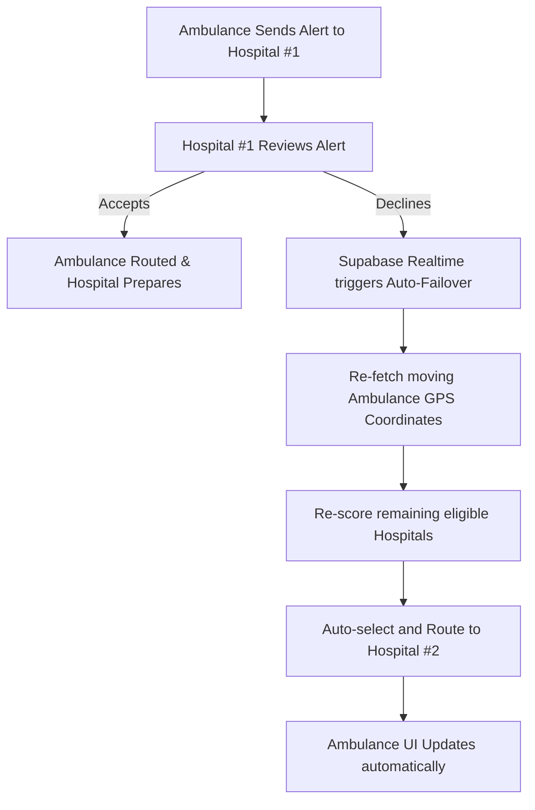

# 🚑 JeevanRoute
### Smart Algorithm-Driven Ambulance Routing — Get to the Right Hospital, Not Just the Nearest One

[](https://nextjs.org)
[](https://react.dev)
[](https://tailwindcss.com)
[](https://supabase.com)
[](https://maplibre.org)
[](#)

---

## 🧠 The Problem

Every year, thousands of patients in India lose their lives during the critical **Golden Hour** (the first 60 minutes after a medical emergency) because ambulances automatically navigate to the *nearest* physical hospital. 

Often, the nearest hospital:
- Lacks vacant ICU or ventilator beds.
- Does not have the required specialist (e.g., Cardiologist, Trauma Surgeon) on duty.
- Lacks the correct blood group or specialized medical equipment.

By the time the ambulance arrives and the facility is determined to be inadequate, critical time is lost. **JeevanRoute solves this coordination issue in under 8 seconds.**

---

## ✨ Features

JeevanRoute connects patients, ambulance operators, and emergency departments through a real-time, smart algorithm-driven dual-dashboard system.

### 🚑 Ambulance Operator Dashboard
- **Structured Intake Form**: Quick input for patient condition (Cardiac, Trauma, Burns, Maternity, Neurological, etc.), severity score (1-10), age, blood group, and allergies.
- **Smart Algo Prediction System**: Algorithmic results determine the exact medical specialties, urgent equipment needed, and initial emergency requirements.
- **Intelligent Recommendations**: Displays the Top 3 best-matched hospitals ranked by a composite score of specialty compatibility, distance, and live bed/ICU availability.
- **Real-Time Routing & Telemetry**: Dynamic map routing using MapLibre, tracking estimated arrival times (ETA).
- **Auto-Failover Logic**: If a chosen hospital declines the incoming emergency, the system automatically detects the state update, captures the moving ambulance's current GPS location, recalculates the triage routing, and alerts the next best hospital instantly.

### 🏥 Hospital ER Dashboard
- **Instant Emergency Alerts**: Real-time popups with audible notifications containing full case details.
- **Interactive Smart Prep Checklist**: A step-by-step checklist dynamically generated for the specific medical emergency (e.g., "Prepare Defibrillator", "O- Blood Standby", "Clear ICU Bay 3").
- **Live Dispatch Telemetry**: Countdowns displaying live ETA and current coordinates of incoming ambulances.
- **Dynamic Decision Board**: Instant Accept/Decline actions to coordinate capacity with nearby dispatchers.

---

## 🔄 Auto-Failover Flow



---

## 🛠️ Tech Stack

| Layer | Technology | Description |
|---|---|---|
| **Frontend** | `Next.js 16` + `React 19` | Modern, responsive server-rendered app structure. |
| **Styling** | `Tailwind CSS v4` | Modern CSS styling. |
| **Database & Realtime** | `Supabase` | PostgreSQL database storing cases/alerts with active WebSockets for instant synchronization. |
| **Maps & Places** | `MapLibre` | Handles routing, map rendering, and live turn-by-turn route calculations. |
| **Prediction System** | `Smart Algo Engine` | Tailors checklists, handles triage classification, and analyzes patient vitals. |

---

## 🚀 Getting Started

### Prerequisites
- Node.js 18+ installed on your system.
- A Supabase project with Realtime enabled.
- A MapLibre compatible maps service configured.

### 1. Clone & Install
```bash
git clone https://github.com/your-team/jeevanroute.git
cd jeevanroute
npm install
```

### 2. Configure Environment Variables
Create a `.env.local` file in the root directory:
```env
NEXT_PUBLIC_SUPABASE_URL=your_supabase_project_url
NEXT_PUBLIC_SUPABASE_ANON_KEY=your_supabase_anon_key
NEXT_PUBLIC_GOOGLE_MAPS_API_KEY=your_google_maps_api_key
GEMINI_API_KEY=your_gemini_api_key
NEXT_PUBLIC_SITE_URL=http://localhost:3000
```

### 3. Setup Database Schema
Initialize your Supabase database using the schema provided:
1. Copy the SQL commands from `supabase/schema.sql`.
2. Paste and run them inside your Supabase Project's SQL Editor.
3. Seed sample hospital data:
   ```bash
   node seed-supabase-js.mjs
   ```

### 4. Run Development Server
```bash
npm run dev
```
Open [http://localhost:3000](http://localhost:3000) in your browser.

---

## 📁 Project Structure

```
jeevanroute/
├── app/
│   ├── page.tsx                    # Landing page / Role selector
│   ├── layout.tsx                  # Global layout wrapper
│   ├── globals.css                 # Base stylesheet
│   ├── auth/                       # Sign in / Sign up flows
│   ├── ambulance/
│   │   ├── page.tsx                # Ambulance main dashboard
│   │   ├── intake/
│   │   │   └── page.tsx            # Patient intake form
│   │   └── results/
│   │       └── [id]/
│   │           └── page.tsx        # Hospital selection and active routing
│   ├── hospital/
│   │   ├── page.tsx                # Hospital emergency control panel
│   │   ├── incoming/
│   │   │   └── page.tsx            # Incoming dispatch alerts (live)
│   │   └── prep/
│   │       └── [alertId]/
│   │           └── page.tsx        # Dynamic prep checklist
│   └── api/
│       ├── alert/                  # Send alerts to hospital
│       ├── auth/                   # Session authentication endpoints
│       ├── case/                   # Live case status query
│       ├── recommend/              # Proximity/Specialty scoring model
│       ├── reroute/                # Failover redirection route
│       └── triage/                 # Smart Algo prediction results parser
├── components/                     # Core React & Glassmorphism UI elements
│   ├── AdminDashboard.tsx
│   ├── DriverDashboard.tsx
│   ├── HospitalCard.tsx
│   ├── SignIn.tsx
│   └── ...
├── lib/                            # Integrations & Utilities
│   ├── maps.ts                     # Distance & route logic
│   ├── supabase.ts                 # Supabase client instantiation
│   └── claude.ts                   # Local classification logic
├── supabase/
│   └── schema.sql                  # Database tables, triggers, and indices
└── package.json
```

---

## 🎯 Demo Guide

To test the real-time failover coordination flow locally:
1. Open two browser windows side-by-side:
   - **Left Window**: [http://localhost:3000/ambulance](http://localhost:3000/ambulance)
   - **Right Window**: [http://localhost:3000/hospital](http://localhost:3000/hospital)
2. Submit a new case on the **Ambulance** dashboard via the Patient Intake screen.
3. Observe the alert immediately appear on the **Hospital** dashboard via Supabase Realtime subscriptions.
4. Click **Decline** on the Hospital screen.
5. Watch the Ambulance view instantly transition into `Rerouting...` status, fetch its current location, and establish a new route to the second-best matched hospital automatically.

---

## 📄 License

This project is licensed under the MIT License - see the LICENSE file for details.
